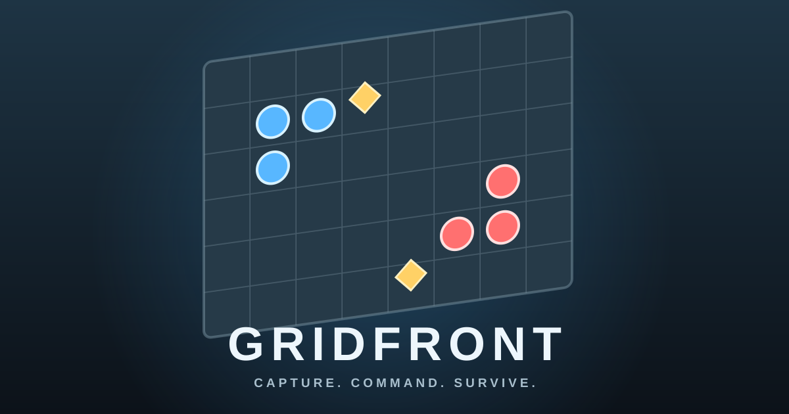

# Gridfront

Gridfront is a compact, turn-based tactical strategy game that runs directly in a modern browser. Command a three-unit squad, move across an 8×8 battlefield, capture supply nodes, and defeat an enemy squad controlled by simple AI.

## Play

Open `index.html` in a modern browser. No installation, external libraries, or assets are required.

- Click a blue unit to select it.
- Click an empty highlighted tile to move (each unit moves once per turn).
- Click a red enemy next to your selected unit to attack (once per turn).
- End your turn to let the enemy act. Units recover their actions on your next turn.
- Stand on either gold supply node when your turn ends to earn supply.
- Defeat every enemy to win.

## Cover

